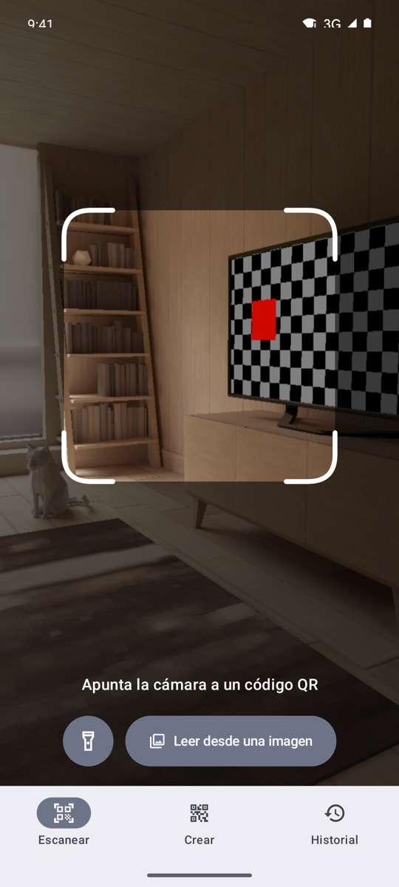
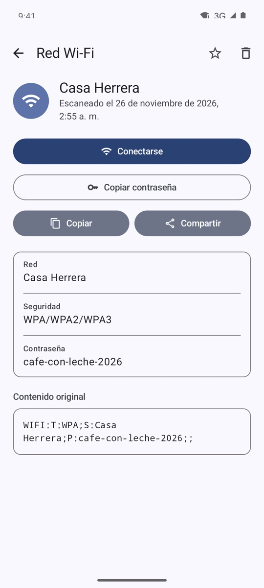
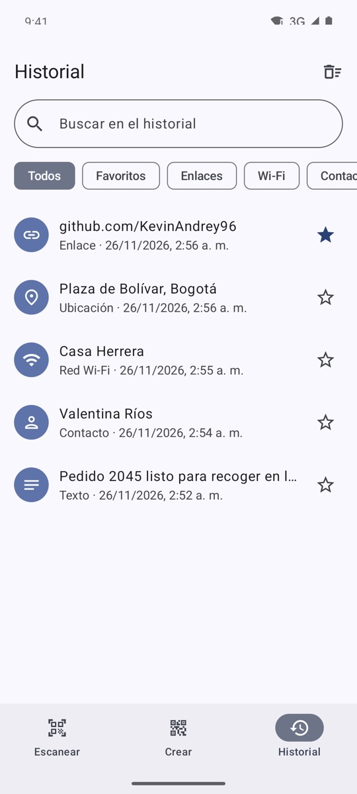
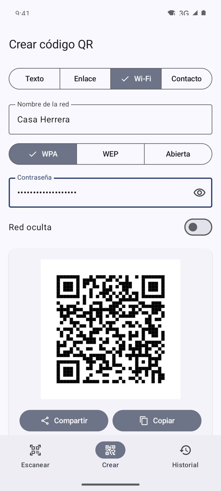

# Lector QR: escáner y generador de códigos QR en Kotlin, Jetpack Compose, CameraX y ML Kit

[](https://github.com/KevinAndrey96/kotlin-compose-qr-code-scanner/actions/workflows/ci.yml)


[](LICENSE)

Aplicación Android que **lee códigos QR con la cámara o desde una imagen de la galería**, entiende lo que contienen (enlaces, redes Wi-Fi, contactos, correos, teléfonos, SMS y ubicaciones), ofrece la acción adecuada para cada uno y guarda un **historial con búsqueda y favoritos**. También **genera códigos QR** de texto, enlaces, redes Wi-Fi y contactos, listos para compartir como imagen.

El reconocimiento corre en el teléfono con ML Kit: no necesita internet ni Google Play Services y ningún código sale del dispositivo.

<p>
  
  
  
  
</p>

## Funcionalidades

- **Escáner en vivo** con CameraX y ML Kit, linterna, vibración al detectar y un marco guía. Si no hay permiso de cámara, la app lo explica y permite leer desde una imagen.
- **Lectura desde la galería** con el selector de fotos del sistema, sin pedir permisos de almacenamiento.
- **Acciones según el contenido**:

  | Contenido | Formatos reconocidos | Acción principal |
  | --- | --- | --- |
  | Enlace | `https://`, `http://`, `www.` | Abrir en el navegador |
  | Wi-Fi | `WIFI:T:WPA;S:...;P:...;;` | Conectarse (panel del sistema en Android 11+) o copiar la contraseña |
  | Contacto | vCard 2.1, 3.0 y 4.0, MECARD | Guardar en Contactos |
  | Correo | `mailto:`, `MATMSG:` | Redactar con asunto y cuerpo |
  | Teléfono y SMS | `tel:`, `SMSTO:`, `sms:` | Marcar o escribir el mensaje |
  | Ubicación | `geo:lat,lon?q=` | Abrir en mapas |
  | Texto | Cualquier otro contenido | Buscar en la web |

- **Historial** en Room: escanear de nuevo un código lo sube al inicio sin duplicarlo, búsqueda sin tildes ni mayúsculas, filtros (enlaces, Wi-Fi, contactos, favoritos) y borrado que conserva los favoritos.
- **Generador** con validación en vivo (longitud de contraseña WPA, correos, teléfonos, tamaño máximo legible) y exportación a PNG mediante `FileProvider`.
- Material 3 con color dinámico en Android 12+, tema claro y oscuro, edge-to-edge, ícono adaptativo y monocromático, y textos en español.
- Las contraseñas copiadas se marcan como sensibles para que Android 13+ no las muestre en la vista previa del portapapeles, y el historial se excluye de las copias de seguridad en la nube.

## Arquitectura

```text
core/                         Módulo Kotlin/JVM puro, sin Android
├── QrContent.kt              Modelo de contenidos (Url, Wifi, Contact, Email, Phone, Sms, Geo, Text)
├── QrContentParser.kt        Detección de formatos con escapes MECARD, vCard y URIs
├── QrDraft.kt                Borradores del generador, validación y armado del payload
├── QrEncoder.kt              Codificación con ZXing a una matriz de módulos
└── Scan.kt                   Escaneo guardado, filtros y búsqueda sin tildes
app/
├── data/                     Room (entidad, DAO con upsert por contenido) y ScanRepository
├── ui/scanner/               CameraX + ML Kit, permisos, lectura desde imagen
├── ui/detail/                Detalle, acciones e intents de cada tipo de contenido
├── ui/history/               Historial con búsqueda y filtros
├── ui/generator/             Formularios, vista previa y exportación a PNG
├── ui/navigation/            Navigation Compose con rutas tipadas y barra inferior
└── QrScannerApplication.kt   Contenedor de dependencias manual
```

| Decisión | Motivo |
| --- | --- |
| Reglas de negocio en un módulo JVM | El parser, la validación y la codificación se prueban en milisegundos, sin emulador |
| ML Kit con modelo incluido | Funciona sin conexión y en dispositivos sin Google Play Services |
| Pantallas con estado separado de su contenido | Cada `XContent` recibe estado y callbacks, así se prueba con Compose UI sin cámara ni base de datos |
| ViewModels con estado de Compose en los formularios | Los campos de texto nunca se desfasan del teclado |
| Deduplicación en una transacción de Room | El mismo código escaneado varias veces queda una sola vez, arriba |
| Inyección manual con `AppContainer` | Un grafo pequeño no necesita Hilt; las dependencias siguen siendo explícitas |
| Advertencias de Kotlin y de Lint tratadas como errores | Las APIs obsoletas se corrigen en el momento y no se acumulan |

## Requisitos y ejecución

JDK 17 o superior y el Android SDK (Android Studio Otter o superior). Gradle descarga la plataforma 37.2 si hace falta.

```bash
# Instalar en un dispositivo o emulador conectado
./gradlew :app:installDebug

# Calidad: formato, Lint, pruebas y cobertura
./gradlew spotlessCheck :app:lintDebug test koverVerifyCoverage koverLogCoverage

# APK de release minificado con R8
./gradlew :app:assembleRelease
```

Cada ejecución de CI publica el APK de depuración como artefacto descargable.

## Calidad

- **26 pruebas** del módulo `core`: todos los formatos del parser con escapes y casos inválidos, validación de borradores, ida y vuelta de payloads y matrices que se vuelven a decodificar con el lector de ZXing.
- **41 pruebas** de la app con Robolectric: repositorio Room en memoria, ViewModels con un repositorio falso y Turbine, intents de cada acción (incluido Android 10 frente a 11+) y pruebas de Compose UI de cada pantalla y de la navegación completa.
- Cobertura combinada del 89 % con Kover y un mínimo del 80 % verificado en CI.
- ktlint (estilo oficial) con Spotless, Android Lint estricto y release con R8 y reducción de recursos.

GitHub Actions corre formato, Lint, pruebas con cobertura y la compilación de los APK en cada push y pull request, y Dependabot mantiene al día Gradle y las acciones.

## Historia del proyecto

Comenzó en octubre de 2018 como un ejemplo de una sola pantalla: un botón que abría el escáner de la librería `zxing-android-embedded` y mostraba el resultado en un `Toast`, con Kotlin 1.2, Support Library y jcenter. Esa versión se conserva en la etiqueta [`v0.1-zxing-sample-2018`](https://github.com/KevinAndrey96/kotlin-compose-qr-code-scanner/tree/v0.1-zxing-sample-2018). En 2026 se reescribió desde cero con Jetpack Compose, CameraX, ML Kit, Room, pruebas y CI.

## Licencia

[MIT](LICENSE) © 2018-2026 Kevin Andrey Herrera Silva
